<div align="center">

<!-- Cyber-Phantom Hero Banner (Matched to PFP) -->


<br/><br/>

<!-- Animated Typing SVG (Crimson & Cyan) -->
<a href="https://github.com/VarshuDev">
  
</a>

<br/>

<!-- Status Badges -->
<p align="center">
  <a href="https://github.com/VarshuDev">
    
  </a>
  <a href="https://github.com/VarshuDev/folio">
    
  </a>
  <a href="https://github.com/VarshuDev/tapbot">
    
  </a>
  <a href="https://github.com/VarshuDev/A1Swaara">
    
  </a>
  <a href="https://github.com/VarshuDev">
    
  </a>
</p>

<!-- Cyber Terminal Telemetry Box -->
```text
┌────────────────────────────────────────────────────────────────────────┐
│  > OPERATOR       : VarshuDev // CYBER-PHANTOM NODE ONLINE             │
│  > CORE STACK     : KOTLIN 2.X • JETPACK COMPOSE • NEXT.JS 16 (TURBO)  │
│  > DECENTRALIZED  : ON-DEVICE TELEGRAM RUNNER • STRONGBOX KEYSTORE     │
│  > AUDIO & DSP    : MEDIA3 EXOPLAYER • 32-BIT PCM • 320 KBPS LOSSLESS  │
│  > PRIVACY SPEC   : ZERO TRACKING • ZERO COOKIES • CRYPTOGRAPHIC HMAC  │
│  > PRIME DIRECTIVE: "BUILD WHAT CANNOT BE TAKEN DOWN."                 │
└────────────────────────────────────────────────────────────────────────┘
```

</div>

<p align="center">
  
</p>

###  Flagship Systems &amp; Architectures

> *Designing sovereign software, high-fidelity media engines, and zero-dependency compilers.*

| Flagship System | Architecture &amp; Engineering Highlights | Stack |
| :--- | :--- | :--- |
|  **[Folio Studio](https://github.com/VarshuDev/folio)** | Opinionated developer portfolio studio &amp; zero-dependency static compiler. Features 22 handcrafted art directions, cookieless HMAC-SHA256 privacy analytics, standalone 48KB offline compilation, and 1-click Vercel REST deployment. | `Next.js 16` &bull; `React 19` &bull; `TypeScript` &bull; `Turbopack` &bull; `Supabase` |
|  **[TapBot](https://github.com/VarshuDev/tapbot)** | Decentralized on-device Telegram bot runner, hardware commander &amp; edge bot store. Runs autonomous bots 24/7 on Android ART coroutines with zero VPS fees, StrongBox AES-256-GCM Keystore security, remote hardware controls, and in-chat direct `/apk` distribution. | `Kotlin 2.x` &bull; `Android ART` &bull; `Compose M3` &bull; `Cloudflare D1/R2` &bull; `StrongBox` |
|  **[A1 Swaara (Source)](https://github.com/VarshuDev/A1Swaara)** | Sovereign native Android music streaming engine &amp; studio suite. Streams 320 kbps unthrottled audio, 32-bit float PCM, 10-band hardware parametric EQ, synced karaoke lyrics, and real-time group Jams. | `Kotlin 2.x` &bull; `Compose M3` &bull; `Media3 ExoPlayer` &bull; `Room SQLite` |
|  **[A1 Swaara (Release Hub)](https://github.com/VarshuDev/A1Swaara_apk)** | Production distribution hub for A1 Swaara, housing standalone Android APK packages (~28.8 MB) and the Windows PC Electron desktop edition with real-time spectrum analyzer. | `Android APK` &bull; `Electron` &bull; `Vite` &bull; `WebAudio API` |

<p align="center">
  
</p>

###  Weapons of Choice &amp; Arsenal

<div align="center">

<!-- Modern Skill Icons Grid (Dark Theme) -->
<a href="https://skillicons.dev">
  
</a>

<br/><br/>

<!-- Categorized Cyber Badges -->
[](https://kotlinlang.org)
[](https://developer.android.com)
[](https://nextjs.org)
[](https://typescriptlang.org)
[](https://developer.android.com/media/media3)
[](https://workers.cloudflare.com)
[](https://supabase.com)
[](https://docker.com)
[](https://kernel.org)

</div>

<p align="center">
  
</p>

###  Live GitHub Activity &amp; Signals

<div align="center">


</div>

<br/>

<p align="center">
  
</p>

<div align="center">

```text
// END OF TRANSMISSION // VARSHUDEV // STAY SOVEREIGN //
```

</div>
